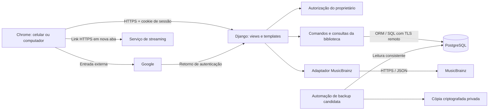

# Music Library — Proposta de arquitetura

**Status:** estrutura geral e cinco decisões de controle e viabilidade aprovadas pelo proprietário na B01; fornecedores e detalhes não avaliados continuam propostos. Não autoriza implementação, criação de contas, contratação ou deploy.
**Data:** 22/10/2026.
**Base:** [PROJECT_SCOPE.md](PROJECT_SCOPE.md) e [REQUIREMENTS.md](REQUIREMENTS.md). Os requisitos detalhados e os esclarecimentos aprovados prevalecem sobre simplificações do escopo, como a obrigatoriedade do ano original.

## 1. Recomendação e limites da avaliação

Construir uma aplicação web com **Python, Django, páginas HTML renderizadas no servidor e PostgreSQL**. Um único projeto concentra interface, regras e acesso aos dados: um monólito, isto é, uma aplicação implantada como uma unidade. Separar responsabilidades por módulos dentro desse projeto, sem serviços independentes.

A coleção ficará no servidor e será consultada pelos dois dispositivos. Recomenda-se login Google por OpenID Connect, integrado por django-allauth, e MusicBrainz como catálogo externo candidato. Serviços de streaming serão somente nomes e links mantidos pelo proprietário; não haverá integração com suas contas.

O proprietário aprovou na revisão da B01 a estrutura geral: monólito Django com responsabilidades internas separadas, páginas renderizadas no servidor e PostgreSQL compartilhado entre os dispositivos. Também aprovou as cinco decisões registradas na seção 13. Essa aprovação não se estende automaticamente às demais bibliotecas, versões, fornecedores ou mecanismos propostos abaixo.

Na elaboração original desta proposta, houve consulta à documentação oficial, sem instalação, testes de aplicação ou validação de serviços externos. Na revisão atual, foi constatado que o projeto já possui repositório Git, estrutura inicial Django, dependências fixadas, configuração de PostgreSQL, arquivo de teste de isolamento do banco e workflow de CI. A existência desses arquivos não comprova execução bem-sucedida. A árvore da seção 3 continua sendo a estrutura pretendida; não representa integralmente os arquivos existentes.

**Conclusão de viabilidade:** o desenho funcional é adequado ao uso pessoal. Orçamento zero, desempenho após inatividade e proteção recuperável com perda máxima de 24 horas ainda exigem provas operacionais. A proposta não considera P08, P10, P12 e P13 encerradas apenas por indicar fornecedores.

## 2. Tecnologias e bibliotecas

| Escolha proposta | Responsabilidade e justificativa | Custo ou limite |
|---|---|---|
| Python 3.13 | Uma linguagem para regras, servidor e testes; adequada ao aprendizado incremental | Confirmar combinação suportada pelas dependências antes de fixar versões |
| Django 5.2 LTS, com correções de segurança atuais | Rotas, formulários, templates, ORM, sessões, proteção CSRF, migrações e testes integrados. ORM é o acesso ao banco por modelos da aplicação | Maior dependência do framework, compensada pela redução de bibliotecas e configuração. A série LTS tem suporte estendido até abril de 2028, segundo a [política oficial](https://www.djangoproject.com/download/) |
| HTML semântico, CSS próprio e JavaScript nativo pontual | Interface responsiva e acessível; JavaScript para submissão acompanhada por identificador de operação e reconciliação de resposta perdida | Formulários e navegação simples permanecem no servidor; testar também a recuperação com falha do JavaScript |
| PostgreSQL e Psycopg 3 | Banco compartilhado com transações, restrições e bloqueios; [Psycopg](https://www.psycopg.org/psycopg3/docs/) conecta Django ao PostgreSQL | Executar integração e concorrência no mesmo tipo de banco usado remotamente |
| django-allauth com provedor Google | Usar implementação mantida do fluxo de identidade; personalizar somente a autorização do proprietário. O [adapter oficial](https://docs.allauth.org/en/latest/socialaccount/adapter.html) permite interromper a entrada antes de concluí-la | Configurações padrão não equivalem a restringir a aplicação a uma conta; cadastro e acesso por senha devem ser desativados |
| Cliente HTTP da biblioteca padrão Python | Consultas HTTPS ao catálogo com timeout, codificação de parâmetros e tratamento de erros | Um adaptador pequeno é suficiente; não adicionar SDK de música ou cliente HTTP assíncrono inicialmente |
| Gunicorn e WhiteNoise, no ambiente remoto Linux | Servir a aplicação e seus arquivos CSS/JS sem outro serviço de arquivos. [WhiteNoise](https://whitenoise.readthedocs.io/en/stable/django.html) integra arquivos estáticos ao Django | Sem uploads no MVP; arquivos de dados e backups não pertencem à pasta de estáticos |
| unittest e ferramentas de teste do Django | Testes unitários, de requisições e de banco sem outro executor; o [Django usa unittest](https://docs.djangoproject.com/en/5.2/topics/testing/overview/) | Usar TransactionTestCase e conexões independentes para concorrência real |
| Playwright para Python, apenas em desenvolvimento | Poucos testes completos no navegador, incluindo duas sessões e perda de resposta; usar a [biblioteca Python](https://playwright.dev/python/docs/intro) com unittest | Navegadores têm custo de instalação e execução; não precisam de Node ou de uma aplicação frontend separada |

Fixar versões exatas e dependências transitivas em arquivo de dependências na preparação do projeto, após verificar compatibilidade e vulnerabilidades. Não fixar neste documento um número de patch que pode envelhecer. PostgreSQL local e remoto devem usar a mesma versão principal suportada pelo fornecedor escolhido.

### Hospedagem candidata, ainda condicionada

- **Aplicação: Render Free**, para piloto. Usa uma URL gratuita e HTTPS, sem exigir domínio próprio. O serviço suspende após 15 minutos sem tráfego e pode levar aproximadamente um minuto para voltar; seu disco é efêmero. Essas limitações impedem usar SQLite local para persistência. O próprio fornecedor desaconselha esse plano para produção. [Limites oficiais](https://render.com/docs/free).
- **Banco: Neon Free**, separado da aplicação. A página consultada anuncia 1 GB por projeto e 100 CU-horas mensais por projeto; CU-hora mede consumo computacional, não número de álbuns. Cotas são compartilhadas com outros usos do projeto. Não concluir capacidade por essa oferta nem contar com histórico de restauração para cumprir sete dias. [Plano oficial](https://neon.com/pricing).
- **Automação candidata: GitHub Actions em repositório privado**, para verificações e avaliação de backups. Há cotas de minutos e armazenamento; conferi-las na conta real e somar testes, artefatos e backups. Não habilitar gastos excedentes. [Regras oficiais de cobrança](https://docs.github.com/en/billing/concepts/product-billing/github-actions).

Render pode cobrar excedentes quando há forma de pagamento; sem ela, a documentação informa desativação do serviço quando haveria cobrança. Confirmar esse comportamento na configuração efetiva e manter somente recursos gratuitos, sem conversão automática. [FAQ do fornecedor](https://render.com/docs/faq).

Essa combinação é candidata para aprender e validar o piloto. Aprovar a arquitetura lógica não comprova que essa hospedagem satisfaz o uso definitivo. Medir tanto aplicação aquecida quanto após inatividade e registrar o atraso, mesmo quando externo; não descontá-lo silenciosamente de tarefas medidas.

## 3. Estrutura de diretórios proposta

```text
music-library/
├── PROJECT_SCOPE.md
├── REQUIREMENTS.md
├── ARCHITECTURE.md
├── manage.py
├── requirements.txt              # versões fixadas para execução
├── requirements-dev.txt          # ferramentas de desenvolvimento
├── .env.example                 # nomes e exemplos sem segredos
├── .gitignore
├── config/
│   ├── settings.py               # configuração por variáveis de ambiente
│   ├── urls.py
│   └── wsgi.py
├── accounts/
│   ├── adapters.py               # autorização da identidade externa
│   ├── middleware.py             # limite absoluto da sessão e acesso
│   ├── management/commands/      # provisionamento orientado do proprietário
│   └── tests/
├── library/
│   ├── models.py                 # entidades e restrições
│   ├── forms.py                  # entrada e erros por campo
│   ├── validation.py             # regras reutilizadas pelos formulários/comandos
│   ├── normalization.py          # chaves de comparação; preserva texto exibido
│   ├── commands.py               # gravações, transações e idempotência
│   ├── queries.py                # leitura, pesquisa e sorteio
│   ├── views.py                  # HTTP, autorização, respostas
│   ├── urls.py
│   ├── migrations/
│   └── tests/
│       ├── test_validation.py
│       ├── test_commands.py
│       ├── test_queries.py
│       ├── test_concurrency.py
│       └── test_views.py
├── catalog/
│   ├── musicbrainz.py            # único adaptador do fornecedor
│   ├── mapping.py                # resposta externa → campos de seleção
│   └── tests/fixtures/           # respostas mínimas e falhas representativas
├── templates/
│   ├── base.html
│   ├── accounts/
│   └── library/
├── static/
│   ├── css/app.css
│   └── js/operations.js          # andamento e consulta de resultado incerto
├── tests/e2e/
├── docs/operations/
│   ├── backup-restore.md         # procedimento futuro aprovado e evidências
│   └── acceptance.md             # rastreabilidade CA → verificação/evidência
└── .github/workflows/           # verificações; backup só após validação
```

Criar arquivos apenas quando a respectiva etapa precisar deles. Não gerar módulos vazios, hierarquias de classes ou aplicações Django por entidade. `accounts`, `library` e `catalog` separam três motivos reais de mudança: identidade, coleção e fornecedor externo.

## 4. Componentes, responsabilidades e comunicação



| Componente | Deve fazer | Limite de responsabilidade |
|---|---|---|
| Templates, CSS e JS | Apresentar dados, coletar entrada, mostrar andamento/erros, preservar edição em conflito e consultar resultado de operação | Não decidem autorização, equivalência ou sucesso de gravação por conta própria |
| Views e formulários | Verificar acesso/CSRF, interpretar requisição, validar formato, chamar comando/consulta e traduzir resultado para interface | Sem SQL disperso ou chamadas ao catálogo dentro de transações de gravação |
| Comandos | Revalidar entrada e autorização, resolver revisão/duplicata confirmada, executar gravação atômica e registrar resultado | Único caminho de escrita dos dados de negócio, inclusive ferramentas administrativas futuras |
| Consultas | Carregar coleção, agrupamentos, sugestões, pesquisa e conjunto do sorteio | Sem alterar dados por consultas GET; controle técnico de tráfego do catálogo é separado |
| Modelos e banco | Tipos, relacionamentos, unicidade, integridade e migrações | Sem transformar semelhança de nomes em equivalência de álbuns |
| Accounts | Validar identidade autorizada, início/fim de sessão e expiração absoluta | Sem contas públicas ou senha alternativa da aplicação |
| Catálogo | Requisitar, limitar tráfego, mapear campos e classificar falhas externas | Não grava álbuns; resposta importada passa pela revisão e validação normal |
| Operação técnica | Verificar saúde, custos, cópias e restauração | Restauração e deploy dependem de autorização específica |

O navegador e o servidor usam a mesma origem, dispensando CORS e uma API pública. Comunicação interna por chamadas de funções com resultados explícitos, sem barramento de mensagens ou eventos distribuídos.

### Contratos HTTP mínimos

Os caminhos abaixo são contratos propostos, não endpoints implementados:

| Interação | Contrato e comportamento |
|---|---|
| Carregar coleção, álbum e serviços | GET de páginas HTML; pesquisa parcial e paginação por parâmetros. Retornar também a revisão dos dados usados pelo formulário |
| Consultar catálogo | GET autenticado com título/artista e página; retornar resultados ou erro identificado; consulta totalmente vazia não chama o fornecedor |
| Criar, editar, excluir, trocar versão ou manter links | POST autenticado com CSRF, `operation_id`, geração operacional, revisão esperada e campos da ação. Exclusões exigem confirmação explícita do impacto |
| Consultar resultado | GET autenticado de `/operations/<uuid>/`, com resposta mínima JSON: concluída, rejeitada ou sem resultado confirmado; sem conteúdo completo de formulários |
| Sortear | POST autenticado, sem gravar histórico; devolver álbum e revisão do conjunto considerado |
| Sair | POST com CSRF; invalidar a sessão daquele dispositivo |

Em gravações confirmadas, usar redirecionamento para consulta quando apropriado; isso evita reenvio acidental por atualização da página. O identificador de operação continua sendo a garantia contra duplicação.

Usar 400 para entrada inválida, 401/403 para ausência de autenticação/autorização nas consultas JSON, 404 para registro removido e 409 para conflito de revisão. Páginas podem direcionar ao login sem dados protegidos. Falhas externas usam respostas de indisponibilidade/limitação identificadas, sem serem convertidas em lista vazia. Timeout de rede no navegador significa resultado não confirmado, não falha de persistência comprovada.

## 5. Persistência e modelo de dados

### Entidades mínimas

| Entidade | Campos conceituais e relações |
|---|---|
| Usuário e identidade externa | Estruturas Django/allauth; somente proprietário previamente provisionado, senha inutilizável, identidade vinculada ao provedor |
| LibraryState | Uma única linha com `revision` crescente e geração operacional UUID. Coordena gravações concorrentes e invalida intenções anteriores a uma restauração; não é suporte a múltiplas bibliotecas |
| Album | ID, título, chave de busca, ano original obrigatório, ano da versão opcional e datas técnicas. Uma linha representa o álbum com sua versão escolhida atual |
| Artist | ID, nome e chave de busca; nomes não são únicos. Registro permanece quando fica sem álbuns |
| AlbumArtist | Associação álbum–artista, posição e indicação do principal quando identificado. Par álbum/artista único, pelo menos uma associação por álbum e no máximo um principal |
| StreamingService | ID, nome e chave única de comparação |
| AlbumLink | ID, álbum, serviço e endereço HTTPS preservado após retirar espaços externos. Unicidade por `(album_id, endereço)` com comparação exata |
| Operation | UUID único, geração operacional, proprietário, tipo da ação, impressão dos dados da solicitação, resultado mínimo, ID afetado quando aplicável, revisão resultante e instante. Não representa histórico de audição |
| CatalogThrottle | Uma linha técnica com instante da próxima chamada permitida, para limitar o catálogo entre processos/dispositivos |

Não criar tabela de todas as edições: só existe uma versão escolhida. No MVP, o dado persistido dessa versão é seu ano opcional; não adicionar nome de edição, capa, faixas ou identificador externo permanente como campos obrigatórios. O resultado externo selecionado pode carregar IDs temporários para buscar os metadados, sem transformá-los em identidade automática da coleção. Se distinguir versões sem ano se tornar necessário, propor novo requisito antes de ampliar o modelo.

“Vários artistas” é um agrupamento representado por um registro de artista, selecionável como os demais. IDs distintos preservam homônimos. Artistas sugeridos nunca são associados automaticamente apenas pelo nome.

### Integridade e validação

- Ano original: inteiro entre 1000 e o ano corrente; ano da versão: nulo ou inteiro no mesmo intervalo e igual/posterior ao original. A entrada aceita somente quatro algarismos ASCII após retirar espaços externos. Nulo significa não informado. O ano corrente usa `America/Fortaleza`, sem fixar 2026.
- Título, artista e serviço: respectivamente 300, 200 e 100 caracteres, não vazios após retirar espaços externos. Medir por pontos de código Unicode para manter consistência entre Python e PostgreSQL; JavaScript deve reproduzir essa contagem quando a exibir. Não depender apenas de `maxlength` do navegador.
- Preservar grafia, pontuação, alfabetos e espaços internos. Normalização serve apenas a chaves auxiliares e comparações.
- Banco garante obrigatoriedade, limites, relações, unicidade e cronologia entre os dois anos. Validar o limite superior dinâmico e o formato original também no comando; um inteiro no banco não preserva a forma digitada. `Model.save()` isolado não substitui esse contrato.
- Garantir ao menos um artista na mesma transação do álbum; unicidade condicional impede dois principais. Interface pode usar o primeiro artista como sugestão de principal, mas não inventar um principal quando a fonte não o identificar.
- Remover álbum elimina links e associações com artistas, preservando artistas e serviços. Remover serviço elimina somente seus links. Configurar cascatas e restrições compatíveis no esquema PostgreSQL por migração; conferir acesso SQL direto, sem depender apenas da exclusão em cascata do ORM.
- O usuário do banco usado pela aplicação não deve alterar o esquema. Uma credencial separada cuida de migrações e outra, de leitura, atende backups. O banco não terá API pública de leitura/escrita para o navegador.

O aplicativo aplica regras de negócio; restrições do banco reforçam o que pode ser expresso declarativamente. SQL administrativo direto exige procedimento controlado e pode contornar validações da aplicação; não deve ser um caminho normal de edição.

### Pesquisa, ordenação e equivalência

Para pesquisa e sugestões, criar chaves usando remoção de espaços nas extremidades, normalização Unicode, remoção de marcas de acento e comparação sem maiúsculas/minúsculas. Usar a mesma função para dados e termos, com testes de acentos e alfabetos. Não normalizar espaços internos nem retirar palavras como “deluxe” por heurística.

Pesquisar substring do título ou nome de qualquer artista associado. Usar `EXISTS` nas associações, ou seleção distinta por ID, para que o álbum apareça uma vez. Termo vazio apresenta a coleção inteira, navegável por páginas; grupos sem álbuns ficam ocultos por consulta, sem apagar artistas.

Comparar título normalizado e conjuntos de nomes normalizados dos artistas para sugerir duplicatas; sinalizar também sobreposição parcial de créditos para revisão de colaborações. Essa sugestão pode ter falsos positivos e negativos e nunca prova identidade. Ano e ID do fornecedor não decidem equivalência. Antes de gravar, reexecutar a verificação sobre dados atuais. Se houver confirmação de equivalência, manter o álbum existente ou trocar sua versão; se forem distintos, permitir continuar. Edição equivalente a outro álbum é bloqueada, sem fusão automática.

Serviços têm chave única de nome sem diferenças de maiúsculas ou espaços externos; **preservar acentos nessa chave**, pois RF06 não aprovou ignorá-los. Links comparam o texto após retirar apenas espaços externos, em collation determinística; não reordenar parâmetros nem unificar URLs por suposta equivalência.

Recomendar ordenação alfabética por collation ICU de português no PostgreSQL, com desempate pelo texto original e ID. Collation é a regra de comparação/ordenação do banco. Validar disponibilidade e permissão no fornecedor antes da migração; não substituir silenciosamente pela ordem binária. As chaves de pesquisa não impõem unicidade de artista ou álbum.

### Migrações e índices

Versionar esquema pelas migrações Django, incluindo restrições e collation. Validar instalação em banco vazio e atualização sobre uma cópia de teste. Não executar migração de produção nesta etapa.

Começar com índices de chaves primárias, estrangeiras e restrições únicas; índice de álbum por título quando a medição justificar sua ordenação. Índice B-tree comum não resolve toda busca por substring. Sem Elasticsearch, extensão de busca aproximada ou índice de trigramas inicialmente. Avaliar plano de consulta e volume antes de adicionar algo.

## 6. Concorrência e resultado incerto — proposta para P09

### Revisão da coleção e transações curtas

Para um proprietário e poucos dispositivos, adotar **uma revisão global da coleção**. Cada formulário e confirmação destrutiva recebe a revisão carregada. Toda gravação:

1. Confere sessão, autorização e estrutura da requisição.
2. Abre transação e bloqueia a linha `LibraryState` com `select_for_update`.
3. Confere a geração operacional emitida no formulário; geração anterior a uma restauração não pode executar. Consulta o identificador da operação; se já existir na geração atual, devolve seu resultado compatível antes de verificar a revisão antiga.
4. Compara revisão esperada com a atual; se divergir, não altera a coleção e retorna conflito com dados atuais e os valores enviados.
5. Revalida campos, associações, sugestões de duplicatas e confirmação de exclusão; realiza a mudança, incrementa a revisão e registra o resultado da operação na mesma transação.
6. Confirma sucesso somente depois do commit, isto é, depois de o banco concluir a transação.

Bloquear sempre na mesma ordem: estado da biblioteca, operação e registros relacionados. Não executar chamadas ao catálogo, identidade ou backup enquanto o bloqueio estiver mantido. A [documentação Django](https://docs.djangoproject.com/en/5.2/ref/models/querysets/#select-for-update) explica o bloqueio por linha e a necessidade de transação.

A primeira gravação válida concluída é preservada; outra baseada na revisão anterior recebe conflito, inclusive ao excluir. A revisão global pode bloquear alterações independentes — por exemplo, editar um serviço depois de cadastrar um álbum em outro dispositivo. É uma escolha deliberada de simplicidade e segurança para este volume. Revisões por entidade ficam para quando conflitos independentes forem frequentes e medidos.

Ao excluir serviço, a confirmação inclui nome, contagem de links e revisão. Se surgir um link após a confirmação, a revisão muda: a exclusão é bloqueada e precisa de nova confirmação do impacto. Se a exclusão concluir primeiro, a inclusão posterior falha por revisão/serviço inexistente. Chaves estrangeiras impedem vínculos órfãos mesmo em falhas.

Em conflito, apresentar lado a lado ou em sequência o conteúdo enviado e os dados atuais; manter a tentativa apenas na página/memória. Novo envio após revisão explícita usa nova revisão e nova operação. Registro removido não é recriado. Não há mesclagem automática ou armazenamento offline do formulário.

### Identificador de operação e repetição segura

Idempotência significa repetir a mesma solicitação sem repetir seu efeito. Gerar UUID ao iniciar uma intenção de gravação e preservá-lo durante envio, consulta e eventual repetição. Valerá para inclusões, edições e exclusões, simplificando um único protocolo.

- UUID é único no banco. A impressão dos campos canônicos da ação impede reutilizar a mesma chave com conteúdo diferente; incluir revisão e decisão sobre possível duplicata. Guardar HMAC, sem cópia integral do formulário.
- Mudança e recibo de sucesso são atômicos: ambos persistem ou nenhum persiste. Resultado de rejeição definitiva pode ser registrado sem alterar a revisão da coleção.
- Se a resposta sumir, mostrar “resultado não confirmado” e consultar a operação. Se existir recibo, recuperar o resultado, mesmo quando o álbum já tiver sido removido depois; informar o fato atual separadamente.
- Ausência de recibo não prova falha: a requisição original pode ainda estar em trânsito ou sem commit. Depois de consultar, uma nova execução técnica só pode usar **o mesmo UUID e os mesmos dados**; o bloqueio e a unicidade convergem para um único efeito. Não criar nova intenção por timeout.
- Se nem a consulta puder ser feita, manter o estado incerto e bloquear repetição. Preservar UUID e dados na página; guardar apenas o UUID em `sessionStorage` para tentar reconciliar após recarga, sem tokens ou conteúdo da biblioteca.
- Sem JavaScript, formular operação com UUID fornecido pelo servidor e oferecer consulta explícita de estado após interrupção. Desabilitar botão é conveniência, não a garantia de unicidade.
- Manter recibos compactos durante o MVP, sem expiração automática: apagar a chave permitiria uma repetição antiga criar outro efeito. Medir crescimento; qualquer descarte futuro exige política de chaves expiradas que não possam voltar a executar.
- Emitir a geração operacional junto ao UUID do formulário e incluí-la na impressão da solicitação. Uma restauração troca essa geração antes de liberar acesso; requisições antigas são recusadas mesmo quando seu recibo não estiver no backup. Isso evita que a revisão restaurada ou a perda de recibos habilite um efeito antigo novamente.

### Sorteio

Carregar IDs distintos de todos os álbuns persistidos, sem filtro por artista, busca atual, links ou página exibida. Escolher um índice com `secrets.randbelow(N)`: o sorteio uniforme recai sobre álbuns, e não sobre suas associações. Repetições são aceitas; não gravar histórico nem estado de audição.

Revalidar a existência do escolhido ao preparar a resposta. Se removido desde a leitura, recarregar o conjunto e sortear novamente; vazio confirmado orienta cadastro, erro de leitura apresenta falha. Um bloqueio curto de `LibraryState` na preparação final permite verificar e materializar os dados sem exclusão simultânea nesse intervalo. Se houver contenção persistente, retornar erro recuperável em vez de repetir indefinidamente.

O ponto de consistência é a preparação da resposta no servidor. Uma exclusão posterior pode tornar qualquer página já exibida desatualizada; não é possível garantir que um álbum nunca seja removido entre enviar HTML e desenhá-lo na tela sem mudar o requisito de atualização. Ao acessar o detalhe/link interno novamente, verificar o estado atual. Não adicionar tempo real por causa dessa janela.

## 7. Identidade, autorização e segurança — proposta para P10

### Entrada e sessão

Usar fluxo de autorização OpenID Connect do Google, pela biblioteca, com retorno ao servidor. Validar emissor, destinatário, assinatura, expiração e mecanismos de correlação do fluxo; não implementar protocolo ou criptografia próprios. Google documenta `sub` como identificador estável da conta e exige configuração de cliente/retorno. [Documentação oficial](https://developers.google.com/identity/openid-connect/openid-connect).

Antes do primeiro acesso à aplicação, provisionar tecnicamente um único usuário local com senha inutilizável e configurar a identidade autorizada `(emissor, sub)` obtida de evidência verificada do provedor em procedimento orientado. Se o identificador ainda não estiver disponível, o procedimento seguro de obtenção/vinculação precisa ser definido e aprovado antes de habilitar o login; não usar “primeira pessoa que entrar vira dona”. E-mail isolado e dados enviados pelo navegador não comprovam identidade.

O adapter rejeita qualquer identidade diferente antes de criar conta ou sessão; cadastro local, cadastro social automático, vinculação por coincidência de e-mail, login por senha e redefinição de senha da aplicação permanecem desabilitados. Proteger também rotas padrão de contas e não expor o admin Django como caminho alternativo. Não criar novos usuários/bibliotecas ao negar acesso. Recuperação da conta continua no Google.

Sessão no banco Django; cookie contém apenas o identificador. Definir expiração absoluta sete dias após a autenticação bem-sucedida, com instante original preservado e verificado em toda requisição protegida. Atualizações da sessão não estendem esse prazo; não confiar apenas em um tempo renovável de cookie. Sair invalida somente a sessão atual, sem encerrar a sessão Google nem a de outro dispositivo. [Mecanismos de sessão Django](https://docs.djangoproject.com/en/5.2/topics/http/sessions/).

Solicitar apenas escopos mínimos de identidade, sem acesso a Drive ou serviços de streaming e sem refresh token se desnecessário. Não guardar tokens externos após concluir o login quando não forem usados. Viabilidade da configuração Google, consentimento, eventuais restrições do modo de teste e custo precisam de validação na conta real.

### Riscos e controles

| Risco | Controle proposto e evidência futura |
|---|---|
| Conta Google válida de terceiro acessar a coleção | Lista prévia por identidade verificada e checagem do proprietário em toda view/comando; testar acesso direto às rotas e resultado de operações |
| Roubo/fixação de sessão | HTTPS; cookies Secure, HttpOnly e SameSite adequado ao retorno de login; rotação na entrada e invalidação na saída; teste com cookie antigo |
| CSRF, uma página externa induzir gravação autenticada | Token CSRF em POST, validação de origem e nenhuma alteração de negócio por GET |
| XSS, metadado executar código na página | Autoescape dos templates e inserção de texto pelo JS, sem HTML externo marcado como seguro; política de conteúdo restritiva e testes com cargas maliciosas |
| SQL injection | ORM e parâmetros; nunca interpolar entrada em SQL, nomes de campos ou ordenação |
| Link executar código ou confundir destino | Validar HTTPS absoluto e domínio sintaticamente válido, incluindo IDN tratado corretamente. Recusar credenciais embutidas, controles e host ausente; sem lista de domínios por serviço, sem resolver DNS ou visitar destino. Preservar URL válida exceto espaços externos |
| Nova aba manipular a página de origem | `target="_blank"` com `rel="noopener noreferrer"`; mostrar o destino como informação de apoio |
| SSRF, servidor acessar endereço arbitrário | Servidor só consulta host fixo do catálogo; links de streaming nunca geram requisição do servidor. Não seguir redirecionamento de catálogo para host arbitrário |
| Exposição por cache/erros/logs | Respostas privadas com `Cache-Control: no-store`; DEBUG desligado, hosts/retornos permitidos explícitos; erros externos sem stack trace ou conteúdo da coleção |
| Vazamento de credenciais e backups | Variáveis protegidas, `.env` fora do Git, usuário de banco com menor permissão e cópia criptografada fora do servidor web |
| Consumo de cota por abuso ou consultas acidentais | Autenticar catálogo, limitar entrada/páginas/tamanho de corpo, limitar chamadas compartilhadas e impor timeout; mensagens explícitas ao atingir limites |

Validar campos também no comando que grava, sem depender do formulário. A senha do provedor nunca passa por um campo da aplicação. TLS deve proteger conexão remota ao banco e a verificação do certificado deve estar habilitada. Confirmar controles de criptografia em repouso do fornecedor antes de usar dados definitivos.

Política proposta de registros: código da ação, horário, duração, status e UUID técnico; sem título, artista, termos de pesquisa, URLs, cookies, tokens ou corpo de requisição. Evitar registrar query strings de buscas. Retenção pretendida de sete dias para logs operacionais, limitada ao mínimo disponível no plano gratuito; confirmar também retenção e acesso dos logs automáticos da plataforma. Recibos de operação têm a política própria da seção 6 e não são logs de diagnóstico. Essa política é proposta, não decisão de privacidade já aprovada.

## 8. Catálogo externo — proposta para P08

Recomendar **MusicBrainz**, sujeito ao piloto de cobertura. Seu modelo distingue release group, que agrupa lançamentos relacionados, de lançamento específico. Isso se aproxima dos dois conceitos exigidos, mas não substitui a confirmação humana de equivalência. [Modelo oficial](https://musicbrainz.org/doc/Release_Group).

A documentação informa consulta não comercial gratuita e identificação apropriada do cliente; os dados têm licenças distintas para núcleo e conteúdo suplementar. Restringir importação aos campos aprovados e conferir sua classificação/licença antes da integração. [Uso da API](https://musicbrainz.org/doc/MusicBrainz_API/FAQ), [licenças](https://musicbrainz.org/doc/About/Data_License).

### Mapeamento e fluxo

1. Pesquisar release groups do tipo primário Album, por título do grupo e/ou artista creditado, com compilations incluídas quando forem álbuns. Escapar sintaxe de consulta e codificar parâmetros. Campo totalmente vazio não envia consulta.
2. Exibir título e artistas creditados, com ano original candidato vindo de `first-release-date` do grupo. Não deduzir ano original da data de uma edição. [Campos oficiais de busca](https://musicbrainz.org/doc/MusicBrainz_API/Search).
3. Permitir selecionar um lançamento específico do grupo, com paginação. Seu `date`, quando disponível e válido, fornece o ano específico; grupo isolado não fornece ano de edição presumido. Se não houver versão identificada, manter esse ano vazio.
4. Extrair ano apenas de data com ano completo válido; ausências/inconsistências ficam explícitas para correção. Metadados são candidatos editáveis: fonte colaborativa não prova a primeira data histórica.
5. Sugerir associações com artistas existentes e permitir criar/escolher homônimos distintos. Não transformar texto combinado de colaboração em associação automática incorreta.
6. Revisar campos, aplicar regras de duplicata e anos, e salvar pelo mesmo comando do cadastro manual. Nenhuma atualização posterior automática do catálogo.

Preservar critérios e posição ao carregar mais resultados; propor páginas de 20 resultados como parâmetro técnico ajustável, sem limite de 20 álbuns na coleção. Não importar capas, faixas ou metadados suplementares.

### Tráfego e isolamento de falhas

A API pede no máximo uma chamada por segundo por aplicação e User-Agent identificável. [Regra oficial](https://musicbrainz.org/doc/MusicBrainz_API). Reservar a próxima chamada numa linha técnica do PostgreSQL, com transação curta, compartilhada entre processos e dispositivos. Se ainda não houver intervalo, devolver espera explícita em vez de iniciar outra chamada. Não usar apenas variável em memória: múltiplos workers a contornariam.

Adotar timeout técnico inicial de 10 segundos por consulta, limite de tamanho da resposta e nenhuma repetição automática em cascata. Tratar limite/503, rede indisponível, JSON inválido, ausência de campos e ausência real de resultados como situações diferentes. Não manter transação de negócio aberta durante a rede. Catálogo indisponível preserva cadastro manual, biblioteca e sorteio, desde que aplicação/banco estejam disponíveis.

O piloto P08 deve verificar 30 álbuns representativos, incluindo coletâneas, colaborações, homônimos, remasterizações, busca só por título, só por artista e paginação. Comparar cobertura e mapeamento dos anos, registrar limites e condições. A documentação consultada não comprova cobertura da coleção do proprietário; algumas páginas oficiais retornaram limitação de acesso durante esta avaliação.

## 9. Desempenho e capacidade — proposta para P12

Começar com renderização no servidor, páginas de 50 álbuns e carregamento dos artistas/links por consultas em lote, evitando uma consulta adicional por item, o problema chamado N+1. Não carregar todos os links em toda lista se a tela não precisar deles. Pesquisa da biblioteca consulta o banco; não depende de baixar a coleção inteira para o navegador.

O sorteio carrega apenas IDs e depois os dados do selecionado. Essa solução tem custo linear no número de álbuns; é adequada como hipótese para biblioteca pessoal e será medida antes de prometer capacidade. Não usar `ORDER BY random()` em todas as associações nem sortear apenas a página visível.

Avaliar dados sintéticos de 30, 1.000 e 10.000 álbuns, com múltiplos artistas e links, para observar tendência de consulta, memória, bloqueios, tamanho de backup e consumo de cotas. Esses tamanhos são amostras de avaliação, não capacidade garantida nem novos limites de negócio. Não existe justificativa para cache distribuído ou infraestrutura de busca nesta etapa.

Registrar tempo de rede, servidor e tarefa do usuário separadamente. Os critérios aprovados são tarefas completas: localizar álbum em até 15 segundos e incluir resultado em até um minuto, três tentativas por tarefa em cada dispositivo. São diferentes de latência de endpoint. Registrar falhas individualmente e comparar aplicação fria/aquecida, sem inventar média de sucesso.

Sem garantia de atualização automática. Recarregar consulta ao abrir a biblioteca e após gravação; conflito protege uma página antiga. Caso cotas, latência de retomada ou crescimento inviabilizem metas, apresentar dados ao proprietário para escolher outra hospedagem ou revisar restrições. Não habilitar plano pago automaticamente.

## 10. Cópias de segurança e recuperação — proposta para P13

### Solução candidata

Avaliar rotina independente da aplicação usando **GitHub Actions, `pg_dump` e criptografia age**, com artefatos em repositório privado. `age` permite criptografar para uma chave pública sem colocar a chave privada de recuperação na automação. [Projeto oficial](https://github.com/FiloSottile/age).

Executar a cada 12 horas para criar margem diante da meta de 24 horas; manter todas as cópias recuperáveis dos últimos sete dias, com retenção configurada e verificada. Horário do agendador deve ser declarado em UTC e apresentado também em America/Fortaleza. O backup não deve depender de tráfego nem de processo em segundo plano no Render Free.

Procedimento futuro:

1. Usar credencial somente de leitura, conexão TLS e `pg_dump` compatível com a versão do servidor para obter uma visão consistente dos dados.
2. Incluir álbuns, artistas, anos, relações, serviços, links, estado/revisão e recibos de operações, além de dados necessários para reconstituir a autorização. Preservar migrações e versão da aplicação junto ao manifesto. Não distribuir cópias de desenvolvimento do banco definitivo.
3. Não restaurar sessões autenticadas ou tokens antigos: excluir esses dados da cópia recuperável, ou descartá-los obrigatoriamente em ambiente isolado antes de qualquer exposição da restauração. Documentar rotação/reprovisionamento de segredos; não incluí-los em manifestos.
4. Criptografar antes do upload; manter chave privada sob controle do proprietário, fora da aplicação e do repositório. Confirmar que consegue recuperá-la em outro dispositivo autorizado.
5. Registrar instante do snapshot e da conclusão, versão do esquema, tamanho, checksum e resultado. Checksum demonstra integridade do arquivo, não que a restauração funcione.
6. Verificar artefato recuperável, retenção e idade do ponto mais recente. Se passar de 18 horas sem cópia válida, sinalizar degradação e permitir acionamento técnico orientado; aos 24 horas, registrar descumprimento da meta.

Somar tamanho de todas as cópias retidas, artefatos de testes e consumo mensal antes de aceitar a solução gratuita. Repositório privado e criptografia são complementares; não disponibilizar backup por link público ou commit. Restringir permissões do workflow e executar acesso a segredos somente em contexto confiável, sem código de PR de terceiros.

### Limitação decisiva

GitHub informa que agendamentos podem atrasar e até perder execuções sob carga. Portanto, dois horários por dia **não garantem**, por si só, perda máxima de 24 horas. [Limitação oficial do agendamento](https://docs.github.com/en/actions/reference/workflows-and-actions/events-that-trigger-workflows#schedule). Notificações e supervisão também precisam de validação e podem compartilhar falhas do agendador.

A solução é candidata de baixo custo, não uma afirmação de conformidade com BK02/BK03. Antes de uso definitivo, demonstrar sete dias de cópias, uma restauração e cenário de falha/recuperação com ponto de no máximo 24 horas. Se o conjunto gratuito não sustentar a meta, P13 permanece bloqueadora do uso definitivo até decisão explícita do proprietário; não reduzir a exigência silenciosamente. Uma semana de sucesso é evidência de operação, não garantia futura de disponibilidade.

### Restauração orientada

Restaurar primeiro em banco isolado, conferir contagens e dados, anos nulos, homônimos, agrupamentos, serviços, endereços exatos, associações e ausência de órfãos. Aplicar a versão adequada do esquema e validar login após invalidar sessões restauradas.

Para substituir a biblioteca em uso, apresentar ponto recuperável, alterações que serão perdidas e plano de retorno; obter autorização explícita antes de qualquer execução. Após autorização, suspender gravações, preservar cópia do estado atual quando possível, restaurar, conferir e liberar acesso. Recibos posteriores ao backup podem ter sido perdidos: invalidar intenções/revisões pendentes com nova geração de operações e impedir reenvios de formulários anteriores à restauração. Não há botão de restauração ou desfazer exclusão no MVP. Prazo máximo de restauração não foi aprovado.

## 11. Estratégia de testes e critérios de aceitação

Aplicar TDD em regras pequenas: RED, escrever teste que falha; GREEN, implementar o mínimo; REFACTOR, melhorar a organização mantendo comportamento. O proprietário escreve testes e implementação, com mentoria. Aprovação deste documento não inicia esse ciclo automaticamente.

| Nível / área | Casos prioritários e rastreabilidade |
|---|---|
| Unidade: validação | VA01–VA07 e VL01–VL07; limites exatos, Unicode, espaços internos/externos, 1000/ano atual/ano futuro com relógio controlado e timezone, campos opcionais nulos, URLs preservadas |
| Unidade: identidade e busca | RF04/RF05, CA-ID01–03; acentos, colaborações, nomes iguais com IDs distintos, sugestões corrigidas e resultados únicos; ordenação e desempates |
| Unidade: sorteio | CA08.1–08.7; conjunto de IDs únicos, ausência de filtros, vazio/um item/repetições; fonte aleatória controlada para conferir todos os índices. Revisar o mecanismo uniforme; frequência de amostra finita não prova igualdade exata |
| Integração: PostgreSQL | RF02–RF07/RF09; persistência, constraints, cascatas reais, rollback e preservação de links ao trocar versão; recusa de gravação inválida pelo comando |
| Integração: concorrência | CA-CC01–07 e CA06.8; duas conexões com barreiras de sincronização, edição/edição, edição/exclusão, novo link/exclusão de serviço, confirmação desatualizada e UUID repetido em paralelo |
| Integração: resultado incerto | Commit seguido de resposta descartada; consulta posterior identifica sucesso; reenvio com mesmo UUID não duplica; UUID com conteúdo diferente é recusado; consulta indisponível mantém incerteza; requisição original atrasada não gera segundo efeito |
| Integração: catálogo | CA01.*; fixtures para título/artista/ambos, paginação, anos ausentes/distintos, 503, timeout, JSON inválido e limite compartilhado; nenhuma chamada na busca totalmente vazia |
| Segurança e sessão | CA10.1–12; acesso sem cookie, terceiro autenticado, rotas padrão de cadastro/senha/admin, CSRF, injeção de HTML/SQL, acesso direto à operação, sete dias absolutos, cookie revogado e saída em apenas uma de duas sessões |
| Navegador | Fluxos essenciais de inclusão manual e externa, editar/trocar versão, excluir/cancelar, artistas, serviços/links, busca, sorteio e conflito com preservação do formulário. Simular perda de resposta e controlar rede |
| Aceitação manual | CA-UI01–05 e CA-PF01–04 nos dispositivos reais, teclado, foco, rótulos, erros por campo, estados sem depender de cor, 360/1280 px sem rolagem horizontal |
| Operação e recuperação | CA-BK01–07; acesso restrito, cobertura de sete dias, idade do ponto recuperável, restauração em banco isolado, conferência e invalidação de sessões/operações antigas |

Usar PostgreSQL descartável para integração e concorrência; SQLite não reproduz os bloqueios escolhidos. As conexões concorrentes devem realmente disputar a mesma linha, não apenas chamar funções sequencialmente. Induzir perda da resposta depois do commit é diferente de interromper antes de enviar.

Mocks, substitutos controlados, ficam nas fronteiras externas: Google, MusicBrainz e rede. Testes de banco usam banco real. Não chamar serviços externos em cada execução; validar login e cobertura reais em sessão de homologação autorizada, sem gravar tokens em evidências.

Integração contínua proposta: testes de unidade e banco, verificação de migrações pendentes e configuração de segurança; poucos testes de navegador nos fluxos críticos. Instalação, serviços locais e workflow serão preparados somente na etapa aprovada. Não impor porcentagem arbitrária de cobertura: priorizar critérios de negócio e falhas relevantes.

Em `docs/operations/acceptance.md`, manter cada CA com tipo de teste, cenário, ambiente, data e evidência; a tabela acima agrupa a estratégia e não substitui essa conferência individual. Registrar versões efetivas de Windows/Chrome e Galaxy S24 FE/Chrome, três tempos individuais por tarefa/dispositivo e condições de conexão. Emulação de navegador não substitui essa aceitação.

## 12. Decisões arquiteturais e alternativas rejeitadas

ADR é um registro curto de decisão: motivo, consequência e quando reconsiderar. A estrutura geral descrita nos registros 01–03 foi **aprovada** pelo proprietário na revisão da B01: monólito Django, HTML no servidor com JavaScript pontual e PostgreSQL compartilhado. O mecanismo de revisão global, transação e recibo por UUID do registro 07 também foi **aprovado**. Os registros 05 e 10 têm aprovação limitada às regras de identidade prévia e validação da infraestrutura gratuita descritas na seção 13; os fornecedores não foram escolhidos. Os demais registros continuam **propostos**. Aprovação de desenho não comprova implementação ou funcionamento.

| ADR | Decisão e motivo | Alternativa rejeitada nesta etapa | Consequência, custo de mudança e revisão |
|---|---|---|---|
| 01 | Monólito Django com módulos internos: um usuário e regras transacionais próximas | Microsserviços, filas, Kubernetes e camadas genéricas de repositório | Uma implantação e menos falhas distribuídas; separar serviços depois custa extrair contratos, só se escala/equipe justificar |
| 02 | HTML no servidor e JS pontual: telas de consulta/formulário | React/Next com API separada, GraphQL e Django REST Framework | Menos ferramentas e duplicação; aplicativo nativo ou interações complexas podem justificar API futura |
| 03 | PostgreSQL compartilhado: dados relacionais, transações e bloqueios | Arquivo JSON, localStorage como fonte principal, SQLite em disco efêmero e banco documental | Exige banco remoto/local; migrar fornecedor PostgreSQL tem custo moderado, menor que trocar modelo de persistência |
| 04 | Django integrado: formulários, sessão, ORM e testes atendem grande parte do problema | Flask/FastAPI com composição manual e Supabase com navegador acessando dados diretamente | Menos componentes para manter; Supabase é viável, mas exigiria políticas de acesso e operações transacionais próprias, sem eliminar regras difíceis |
| 05 | Google/allauth e sessão no servidor: sem senha própria ou tokens no navegador | Autenticação caseira, senha compartilhada, JWT em localStorage e autorização só visual | Configuração rigorosa de identidade prévia e sessão; trocar provedor exige novo vínculo verificado, não migrar biblioteca |
| 06 | MusicBrainz candidato: distinção grupo/lançamento e consulta não comercial | Spotify/Discogs como catálogo principal e catálogo hospedado pelo projeto | Não usar plugins da conta pessoal como backend do produto; cobertura e APIs alternativas só serão avaliadas se o piloto falhar. Adaptador concentra custo de troca |
| 07 | Revisão global, transação e recibo por UUID: cumprir conflitos e repetição segura | Última gravação vence, botão desativado como única proteção e fusão automática | Pode gerar conflitos entre ações independentes; migrar para revisão por entidade exige novos testes e protocolo, só com evidência de necessidade |
| 08 | Uma linha por álbum e artistas por ID: versão substituível e homônimos | Uma linha por edição, nome de artista único e unicidade automática por título/artista | Equivalência continua decisão humana; múltiplas versões simultâneas exigiriam mudança explícita dos requisitos |
| 09 | Consultas simples, paginação e índices relacionais básicos | Elasticsearch, Redis, busca aproximada e cache da coleção no cliente | Substring e sorteio têm custos a medir; otimizar depois é localizado, enquanto infraestrutura extra aumenta operação desde o início |
| 10 | Render/Neon gratuitos para avaliação, backups externos candidatos | Banco temporário Render como coleção definitiva, backup no mesmo disco web e plano pago implícito | Hospedagem final permanece condicionada a desempenho/cotas/recuperação; troca do host web é pequena se configuração ficar externa |
| 11 | Backup técnico criptografado, com demonstração de restauração | Confundir histórico de provedor com sete cópias diárias ou confiar só em agendamento | Operação adicional inevitável por BK01–07; fornecedor de automação/armazenamento pode mudar sem mudar domínio |

Não adicionar Docker obrigatório ao produto, sistema de plugins, múltiplas bibliotecas, permissões por papéis, domínio genérico de edição musical ou infraestrutura de observabilidade separada. Cada dependência futura deve resolver uma necessidade demonstrada.

## 13. Pendências, aprovação e próximos limites

### Decisões aprovadas na B01

Em 22/10/2026, o proprietário aprovou explicitamente, além da estrutura geral, as seguintes decisões:

| Decisão | Alcance da aprovação e consequência |
|---|---|
| Revisão global da coleção | Comparar a revisão recebida com a atual e realizar a gravação sob transação e bloqueio curto. Uma tentativa desatualizada recebe conflito, preservando seus valores e apresentando os dados atuais. Aceita-se que mudanças independentes também provoquem conflitos; reconsiderar revisão por entidade se isso se tornar frequente no uso real |
| Identificador de operação e repetição segura | Usar UUID por intenção de gravação e persistir a alteração e seu comprovante na mesma transação. Em resposta perdida, consultar a operação; uma repetição usa o mesmo UUID e os mesmos dados, sem duplicar o efeito. Isso não determina equivalência entre álbuns |
| Geração operacional após restauração | Trocar a geração após restaurar o banco, antes de liberar acesso. Recusar formulários de gerações anteriores, mesmo quando seus comprovantes não existirem no backup, exigindo carregar os dados novamente |
| Identidade previamente autorizada | Vincular previamente a identidade verificada do proprietário e recusar outras contas sem criar usuário ou sessão. Não conceder propriedade ao primeiro login; manter cadastro público e senha alternativa da aplicação desabilitados. Recuperação da conta pelo provedor; escolha e procedimento de verificação permanecem para B04 |
| Infraestrutura gratuita condicionada à validação | Tratar hospedagem, banco e automação como candidatos. Avaliar retomada após inatividade, cotas e recuperação; não aceitar cobrança automática nem reduzir as metas aprovadas. Se a solução gratuita não atender aos requisitos, apresentar a limitação ao proprietário antes do uso definitivo |

Essas aprovações são decisões de arquitetura. Não comprovam concorrência, integração de identidade, desempenho ou recuperação e não autorizam configurar serviços externos.

| Pendência dos requisitos | O que esta proposta define | Evidência/decisão ainda necessária |
|---|---|---|
| P08 — catálogo | MusicBrainz, mapeamento e isolamento por adaptador | Cobertura real, dados dos anos, paginação, licença aplicável e respeito aos limites em ambiente compartilhado |
| P09 — concorrência | Revisão global, bloqueio transacional, recibos e reconciliação aprovados | Demonstrar corridas/perda de resposta; revisar e validar o ponto de consistência do sorteio |
| P10 — acesso | Regra de identidade prévia aprovada; Google/allauth candidatos, sessão absoluta e saída local propostas | Definir procedimento seguro de obtenção da identidade, aprovar política de registros e validar provedor, configuração gratuita, rotas e controles reais na B04 e nas tarefas de implementação |
| P11 — interface | HTML responsivo e testes de teclado/campos | Execução futura nos dispositivos e registro de versões; nenhuma compatibilidade presumida |
| P12 — capacidade | Paginação, medições crescentes e protocolo aprovado preservado | Tempos reais, retomada após inatividade, cotas e volume; sem capacidade máxima prometida |
| P13 — recuperação | Dump consistente, criptografia, retenção e restauração orientada | Provar acesso restrito, sete dias e ponto recuperável de até 24 horas; agendamento gratuito não garante a meta |

As decisões acima registram o alcance da aprovação do proprietário. Bibliotecas, fornecedores e detalhes técnicos ainda propostos precisam de avaliação e decisão antes de seu uso. As provas externas e configuração de serviços dependem de etapa autorizada; este documento não as executa.

Após aprovação, a primeira microtarefa sugerida é definir um teste pequeno das validações de anos e explicar por que elas precisam existir também no comando que grava. O proprietário continua autor de testes e implementação. Preparação de Git/ambiente, instalação, configuração de serviços, migrações e deploy exigem suas respectivas autorizações e não estão incluídos na gravação deste documento.

**Revisão ativa:** explique por que um UUID evita duplicar uma solicitação, mas não decide se dois álbuns são edições equivalentes; e por que uma rotina diária de backup não comprova perda máxima de 24 horas.

**Evidência da elaboração original:** documentos locais e documentação pública consultados, com produção desta proposta sem implementação ou validação de fornecedores naquela etapa.

**Evidência da revisão da B01:** repositório Git e arquivos da preparação inicial conferidos; branch de trabalho `docs/b01-revisao-arquitetura`. A estrutura geral e as cinco decisões acima foram aprovadas explicitamente pelo proprietário, que autorizou seu registro documental. A revisão ativa sobre UUID foi realizada, e o proprietário autorizou o fechamento da B01 em 22/10/2026. As validações técnicas futuras continuam pendentes. Nesta revisão documental, não foram executados testes de aplicação, instalações, integrações externas ou deploy.

## 14. B02 — avaliação e fechamento

**Data da consulta documental:** 23/10/2026.

**Status:** avaliação concluída em 23/10/2026, com limitações registradas e fechamento autorizado pelo proprietário na branch `docs/b02-infraestrutura`. Render Free, Neon Free e GitHub Actions permanecem candidatos para as próximas avaliações; não houve aprovação de uso definitivo.

### Cotas, suspensão e persistência

| Candidato / recurso | Evidência documental | Consequência e pendência |
|---|---|---|
| Render Free — aplicação | Suspende após 15 minutos sem tráfego; retomada leva aproximadamente um minuto. Alterações no disco local se perdem ao suspender, reiniciar ou republicar | Manter a coleção em PostgreSQL externo. Medir retomada e impacto na meta de pesquisa em até 15 segundos |
| Render Free — horas | 750 horas mensais por workspace, compartilhadas pelos serviços gratuitos; ao esgotar, suspende esses serviços até o mês seguinte | Conferir consumo compartilhado na conta |
| Render — transferência | Sem forma de pagamento, exceder a cota suspende serviços gratuitos pelo restante do mês; com pagamento, pode haver cobrança adicional | Conferir a cota efetiva do plano e impedir cobrança automática antes da configuração |
| Render Hobby — preparação de publicação (build) | 500 minutos mensais. Sem forma de pagamento ou ao atingir o limite de gastos, bloqueia novas preparações; a versão publicada pode continuar ativa | Conferir plano, consumo e limite de gastos efetivos |
| Neon Free — processamento e transferência | 100 CU-horas de processamento e 5 GB de transferência pública por projeto/mês. Esgotar um desses recursos suspende o processamento até o próximo ciclo, sem mudança de plano | Conexões existentes caem e novas conexões ficam bloqueadas; medir consumo real |
| Neon Free — armazenamento | 1 GB por projeto e 20 GB no total da conta. Ao atingir o limite, operações que aumentem o armazenamento falham. Esses limites não se renovam mensalmente | A documentação informa que exceder cotas do Free não apaga os dados nem gera cobrança excedente; isso não substitui backup |
| GitHub Actions — automação | Para GitHub Free em repositório privado: 2.000 minutos mensais e 500 MB de artefatos; artefatos compartilham a franquia de armazenamento com GitHub Packages. Sem pagamento válido, esgotar cotas bloqueia o uso | Confirmar plano, visibilidade, consumo compartilhado e controles de gastos na conta real; somar testes e futuros backups |

CU-hora mede consumo computacional, não quantidade de álbuns. As cotas anunciadas não comprovam capacidade para a biblioteca. No Neon, a suspensão por inatividade ocorre após cinco minutos e preserva os dados; é diferente de esgotar a franquia mensal.

**Fontes oficiais:** [Render Free](https://render.com/docs/free), [preparação de publicações no Render](https://render.com/docs/build-pipeline), [planos do Neon](https://neon.com/docs/introduction/plans), [limites do Neon Free](https://neon.com/faqs/free-plan-limits-and-quotas) e [cobrança do GitHub Actions](https://docs.github.com/en/billing/concepts/product-billing/github-actions).

Se o banco estiver indisponível, informar falha de consulta; mostrar coleção vazia exige consulta bem-sucedida sem resultados. Nas gravações, preservar o tratamento de resultado incerto da seção 6, sem presumir falha ou sucesso pela queda da conexão.

### TLS e permissões do banco

TLS criptografa a conexão. O Neon suporta `sslmode=verify-full`, que verifica a cadeia de confiança do certificado e sua correspondência com o nome do servidor. A proposta é configurar esse modo e os certificados confiáveis no ambiente da aplicação. A conexão local pelo `psql` teve TLS observado, conforme a evidência abaixo; a configuração e a conexão do Django ainda não foram validadas. [Conexão segura no Neon](https://neon.com/docs/connect/connect-securely).

Aplicar o menor privilégio: conceder somente o acesso necessário a cada finalidade.

| Credencial proposta | Responsabilidade e limite |
|---|---|
| Aplicação | Consultar, inserir, editar e excluir dados necessários ao funcionamento, incluindo permissões auxiliares necessárias; sem administrar usuários nem alterar a estrutura |
| Migrações | Alterar a estrutura do banco, como criar tabelas; manter essa credencial separada da usada no atendimento às requisições |
| Backup | Ler os objetos e dados necessários à cópia, sem alterar dados; detalhar na B05 e comprovar nas tarefas de recuperação |

Papéis criados pelo painel, API ou CLI do Neon recebem associação a `neon_superuser`. Para credenciais restritas, criar papéis via SQL e conceder permissões explicitamente, conferindo também permissões herdadas e públicas. Apagar uma tabela não exige necessariamente superusuário: seu proprietário também pode fazê-lo. A credencial da aplicação não deve ser proprietária das tabelas. [Papéis no Neon](https://neon.com/docs/manage/roles), [controle de acesso](https://neon.com/docs/manage/database-access) e [permissões no PostgreSQL](https://www.postgresql.org/docs/current/ddl-priv.html).

### Ordenação em português

Collation é a regra de comparação e ordenação de textos. Manter a proposta da seção 6: usar ICU de português, com desempate pelo texto original e ID. ICU é uma biblioteca que oferece regras por idioma; sua disponibilidade depende da preparação do servidor PostgreSQL. Criar uma collation exige permissão `CREATE` no esquema de destino. [Collations no PostgreSQL](https://www.postgresql.org/docs/17/collation.html) e [CREATE COLLATION](https://www.postgresql.org/docs/current/sql-createcollation.html).

A consulta documental inicial não confirmou suficientemente a disponibilidade no Neon. Na avaliação prática posterior, executada pelo proprietário, a consulta a `pg_catalog.pg_collation` retornou `pt-BR-x-icu`, com locale `pt-BR`. A consulta de ordenação também funcionou sob o papel de avaliação `music_library_b02_app`, conforme os resultados compartilhados abaixo. Isso comprova disponibilidade e uso nessa conexão e amostra, sem exigir criação de uma collation própria.

O ID resolve empates de ordenação entre registros e ajuda a estabilizar a paginação quando os dados não mudam; ordenar não determina se dois artistas representam a mesma pessoa. Diferenças de caixa, paginação real e integração com as futuras tabelas ainda não foram testadas.

### Evidências da avaliação prática no Neon

Após autorizações específicas, o proprietário criou a conta e o projeto no Neon e executou os comandos no SQL Editor. As evidências deste registro são as capturas de tela e os resultados compartilhados na conversa, não uma execução remota pelo agente.

| Verificação | Evidência apresentada e alcance |
|---|---|
| Projeto de avaliação | As telas mostram o projeto `music-library`, a branch do Neon `production` e região AWS US East 2 (Ohio). A tela Overview confirma `Version 16`, coerente com a escolha informada pelo proprietário; não houve consulta de versão ao servidor. A branch do Neon é independente da branch Git `docs/b02-infraestrutura` |
| Plano e cotas exibidos em Billing | A captura identifica `Free Plan` como plano atual, por US$ 0/mês, com 1 GB de armazenamento por projeto, 100 horas de processamento anunciadas, escalonamento até 2 CU e 10 branches. A página também oferece um adicional por US$ 10/mês; a imagem não indica contratação desse adicional. A seção de forma de pagamento não foi inspecionada |
| Forma de pagamento — relato do proprietário | Ao ser perguntado se cadastrou cartão ou outra forma de pagamento na criação da conta Neon, o proprietário respondeu que não cadastrou nada e autorizou registrar essa informação. Trata-se de relato do proprietário, sem inspeção da seção de pagamento ou verificação independente de todos os meios de cobrança da conta |
| Consumo exibido em Overview | Em Usage, com início indicado em 23/10/2026, o painel mostra Compute em 0 CU-hrs e Storage, History e Network transfer em 0 kB. São valores exibidos na captura, não prova de ausência de consumo: as consultas anteriores executaram. Não foi verificada a frequência de atualização nem a precisão de apresentação desses indicadores |
| Processamento e histórico exibidos em Overview | A tela mostra Default compute de 0,25 a 2 CU, uma branch e History retention de 6 horas. Essa janela não cobre, por si só, a exigência de recuperação dos últimos sete dias; a solução de cópias e recuperação permanece pendente em B05 e nas tarefas de demonstração |
| Conexão administrativa | `neondb_owner`: `superusuario = false`, mas pode criar bancos e papéis, é membro de `neon_superuser` e pode criar objetos no esquema `public`. Não usar essa credencial no atendimento cotidiano da aplicação |
| Papel de avaliação | Criação de `music_library_b02_app` com `NOLOGIN`, `NOSUPERUSER`, `NOCREATEDB`, `NOCREATEROLE`, `NOREPLICATION` e `NOBYPASSRLS`; o editor informou sucesso. A consulta posterior confirmou login, superusuário, criação de bancos/papéis e associação a `neon_superuser` como `false`; `USAGE` em `public` como `true` e `CREATE` como `false`. Não é uma auditoria de todas as permissões efetivas |
| Tentativa inicial de assumir o papel | `SET LOCAL ROLE music_library_b02_app` falhou com SQLSTATE `42501`; a consulta de ordenação não executou nessa tentativa. O proprietário confirmou o encerramento por rollback. A leitura posterior mostrou `MEMBER = true` e `SET = false` para `neondb_owner` em relação ao papel |
| Ajuste autorizado da associação | Após autorização, o proprietário executou `GRANT music_library_b02_app TO neondb_owner WITH SET TRUE`. A consulta posterior retornou `pode_assumir_papel = true`. A autorização permite ao administrador assumir o papel; não concede poderes administrativos ao papel de avaliação |
| Ordenação sob papel restrito | Bloco com `BEGIN READ ONLY`, `SET LOCAL ROLE`, consulta sobre `VALUES` e `COMMIT` executou sem erro. As cinco linhas retornaram `papel = music_library_b02_app`, ordenadas por nome com `pg_catalog."pt-BR-x-icu"`, texto original com `pg_catalog."C"` e ID: Álvaro (2), Ana (1), João (12), João (37), Zeca (3) |

As consultas de ordenação não criaram tabelas nem gravaram dados da coleção. O papel foi criado e a associação foi alterada no banco remoto, com autorização. `NOLOGIN` permanece no papel; não foram criadas credenciais de conexão para a aplicação. O teste por `SET ROLE` não comprova autenticação independente, TLS da aplicação ou acesso às futuras tabelas. A leitura de `USAGE`/`CREATE` em `public` não comprova ausência de permissões em todos os outros objetos.

**Referências para interpretar as consultas:** [catálogo de collations do PostgreSQL 16](https://www.postgresql.org/docs/16/catalog-pg-collation.html), [atributos dos papéis](https://www.postgresql.org/docs/16/view-pg-roles.html) e [funções de consulta de privilégios](https://www.postgresql.org/docs/16/functions-info.html).

### Evidência de TLS na conexão local pelo psql

Com autorização específica para uma verificação externa de leitura, o proprietário conectou pelo terminal ao endpoint com pooling do Neon, usando `neondb_owner`, e compartilhou os resultados. O agente não executou essa conexão. Na preparação local, foram verificados `psql` 16.15 e a disponibilidade de `/etc/ssl/certs/ca-certificates.crt`; não houve instalação ou alteração de arquivos de configuração.

O comando orientado usava `psql -X -W`, `sslmode=verify-full`, `sslrootcert=/etc/ssl/certs/ca-certificates.crt`, timeout de conexão de 15 segundos e `default_transaction_read_only=on`. A senha era solicitada no prompt, sem compor o comando. Ao ser perguntado especificamente sobre os parâmetros `sslmode` e `sslrootcert`, o proprietário confirmou que não os modificou e autorizou registrar essa confirmação. O uso desses parâmetros é sustentado por seu relato; o agente não executou a conexão nem inspecionou o comando efetivamente usado.

| Verificação | Resultado apresentado e alcance |
|---|---|
| Consulta inicial de pg_stat_ssl | Para `pid = pg_backend_pid()`, retornou `ssl = false`, com versão e cifra vazias. A consulta descreve o trecho de conexão visto pelo PostgreSQL e foi insuficiente para verificar o TLS entre o cliente local e o endpoint intermediário do Neon. O resultado não comprova tráfego local sem criptografia nem identifica, sozinho, a configuração interna do provedor |
| Inspeção pelo cliente | `\conninfo` informou conexão a `neondb` como `neondb_owner` e `SSL connection (protocol: TLSv1.3, cipher: TLS_AES_256_GCM_SHA384, compression: off)`. Isso comprova o TLS observado pelo cliente nessa sessão |
| Verificação do certificado e nome | O proprietário confirmou que manteve `sslmode=verify-full` e `sslrootcert=/etc/ssl/certs/ca-certificates.crt` sem modificações. Combinada com a conexão bem-sucedida e a saída de `\conninfo`, essa confirmação sustenta que a verificação do certificado e do nome do servidor passou nessa sessão local. A saída de `\conninfo`, isoladamente, não confirma o valor de `sslmode` |

A verificação cobre uma conexão local com papel administrativo ao endpoint com pooling. Não valida a conexão independente do papel `NOLOGIN`, a configuração TLS do Django ou do futuro ambiente de hospedagem, nem testes de rejeição de certificado/nome inválido. Foi orientado encerrar a sessão com `\q`; o encerramento não foi apresentado como evidência.

**Referências:** [TLS e verify-full no PostgreSQL 16](https://www.postgresql.org/docs/16/libpq-ssl.html) e [comandos do psql](https://www.postgresql.org/docs/16/app-psql.html).

### Evidências da inspeção do Render

O proprietário acessou sua conta existente pelo GitHub e compartilhou capturas do workspace `My Workspace` e de Billing. As evidências abaixo refletem o painel apresentado, sem acesso remoto do agente à conta ou alteração das configurações.

| Verificação | Evidência apresentada e alcance |
|---|---|
| Plano e pagamento | Current Plan: Hobby. Payment Method: `No card on file`, confirmando ausência de cartão cadastrado naquele momento |
| Horas gratuitas e transferência | Monthly Included Usage mostra 0 de 750 horas gratuitas e 0 MB de 5 GB de transferência |
| Preparação de publicações | Included Pipeline Minutes mostra 0 de 500 minutos. A captura posterior de Settings → Build Pipeline confirma Starter selecionado, com 500 minutos gratuitos e limite mensal de gastos de US$ 0. O aviso informa que, esgotados os minutos com esse limite atingido, builds e outras tarefas de preparação param. A tarifa anunciada de US$ 5 por 1.000 minutos adicionais não indica contratação ou cobrança efetiva |
| Recursos compartilhados | Billing informa que as cotas se aplicam ao workspace inteiro; há 3 de 25 serviços e 0 de 2 domínios personalizados. A tela anterior de Projects mostra 1 serviço ativo e 2 suspensos; não foram conferidos seus tipos ou planos individuais |
| Valores financeiros exibidos | Cobrança acumulada no mês e projeção para outubro: US$ 0,00. Saldo de créditos: US$ 0,00. As faturas visíveis de julho, agosto e setembro de 2026 aparecem como pagas, com total de US$ 0,00; isso não indica cartão cadastrado |

Os valores de consumo zerados registram o que estava exibido; não garantem ausência de consumo futuro ou capacidade disponível durante o piloto. Os serviços existentes compartilham as cotas aplicáveis e precisam ser considerados na avaliação, sem alterá-los nesta etapa. O aviso genérico de cobrança por excedentes na página não substitui a regra documental para contas sem forma de pagamento, descrita acima, nem comprova que um excedente foi testado.

Nesta inspeção não houve criação de serviço, publicação da aplicação, cadastro de cartão ou mudança do plano ou do limite de gastos. A cota de transferência do Render (5 GB) e o limite de gastos de preparação de publicações (US$ 0/mês) têm evidência no painel. Esse limite é específico dos builds e outras tarefas de preparação, não um teto global para todos os recursos do Render. O bloqueio ao esgotar minutos foi descrito pelo painel, sem teste de esgotamento. Permanece pendente a medição do comportamento da aplicação, incluindo retomada após inatividade.

### Evidências da inspeção do GitHub Actions

O proprietário compartilhou capturas de Billing and licensing da conta pessoal, incluindo Overview, Actions e Budgets and alerts. A inspeção foi visual, sem alteração de configurações ou execução de workflows nesta etapa.

| Verificação | Evidência apresentada e alcance |
|---|---|
| Plano | Overview identifica GitHub Free por US$ 0/mês |
| Visibilidade do repositório | A captura da página `FilipeMadeira13/music-library` mostra o indicador Public. A visibilidade de `music-library-app` não foi conferida. A consulta não alterou a visibilidade ou as configurações dos repositórios |
| Uso faturável de Actions | No período Current month, a aba Actions mostra US$ 0 faturável, composto por US$ 0,09 de uso bruto e US$ 0,09 de descontos. A origem dos descontos não foi investigada; não inferir visibilidade dos repositórios ou cobrança de US$ 0,09 a partir desses valores |
| Franquias exibidas | Actions minutes: 0 de 2.000 minutos usados. Actions storage: 0 GB de 0,5 GB usados. Esses são os valores apresentados; não comprovam ausência de execuções ou garantia de capacidade futura |
| Uso por repositório | A lista atribui uso bruto a `music-library-app` (US$ 0,06) e `music-library` (US$ 0,03). A conta tem usos de mais de um repositório, que devem ser considerados ao planejar a franquia compartilhada |
| Orçamento e bloqueio | Budgets and alerts mostra orçamento de Actions no escopo Account para `FilipeMadeira13`, com limite de US$ 0 e US$ 0 gastos, marcado como 100% e `Usage blocked`. É evidência do controle de gastos adicionais indicado pelo painel, não um teste de esgotamento. A marcação não significa que a franquia gratuita acabou |
| Alertas | Included usage alerts aparece como On; recebimento e entrega dos alertas não foram testados |

Não foi necessário mudar o orçamento: o limite zero já estava exibido. Não foram inspecionados os detalhes internos de edição desse orçamento nem a forma de pagamento da conta. O uso efetivo dos workflows ainda precisa ser conferido para planejar testes e backups; as franquias e o controle de gastos observados não demonstram a viabilidade da recuperação gratuita.

**Ajuste da premissa para testes:** como `music-library` é público, aplica-se a gratuidade de execução de Actions com runners padrão hospedados pelo GitHub, conforme as [regras oficiais](https://docs.github.com/en/billing/concepts/product-billing/github-actions). Essa regra é compatível com uso bruto compensado por descontos, mas a origem dos descontos exibidos não foi investigada. Runners maiores e outros recursos têm regras próprias; não interpretar a gratuidade de execução como ausência de cotas para todos os recursos.

**Ajuste da proposta de backups:** a solução candidata da seção 10 pressupõe artefatos em repositório privado; o repositório público do código não satisfaz essa premissa. Na B05, avaliar armazenamento privado separado, que pode ser um repositório privado dedicado ou outra alternativa gratuita, mantendo criptografia antes do envio, controle de acesso e validação de cotas e retenção. A franquia aplicável ao armazenamento e à automação privados deve ser avaliada separadamente da execução gratuita dos testes públicos. Este registro não autoriza mudança de visibilidade, criação de outro repositório ou envio de backups. A escolha do destino permanece pendente.

### Decisão de fechamento, evidências e próximos limites

Manter Render Free, Neon Free e GitHub Actions em avaliação para o piloto. A retomada do Render é um risco explícito para a meta de pesquisa, sem medição que comprove atendimento ou inviabilidade. Não aceitar cobrança automática. A disponibilidade e o uso da ordenação em português na amostra foram demonstrados sob o papel de avaliação. O painel do Neon confirmou plano Free, versão 16 e as cotas descritas na captura de Billing; os indicadores de consumo também foram localizados. O proprietário relatou não ter cadastrado forma de pagamento na criação da conta Neon; a seção de pagamento e os demais controles de cobrança não foram inspecionados. No Render, foram confirmados plano Hobby, ausência de cartão, cotas compartilhadas, valores financeiros exibidos e limite de gastos de builds em US$ 0/mês. No GitHub, foram confirmados plano Free, franquias de Actions exibidas, visibilidade pública de `music-library` e orçamento de Actions de US$ 0 no escopo da conta, com bloqueio indicado e alertas de uso incluído ativados. Continuam pendentes a inspeção dos controles de cobrança do Neon, a conferência da cota efetiva de transferência do Neon no painel, o planejamento do uso compartilhado de Actions e a escolha de armazenamento privado de backups na B05, as permissões nas futuras tabelas, a conexão da aplicação com TLS e os demais cenários de ordenação. Recuperação e backups serão aprofundados na B05 e demonstrados nas tarefas posteriores; as seis horas de histórico exibidas não encerram essa validação.

**Revisão ativa realizada:** o proprietário reconheceu o risco do disco efêmero e distinguiu indisponibilidade de coleção vazia. Na mentoria, foram esclarecidas a diferença entre superusuário e proprietário de tabela e a função do ID no desempate da ordenação.

**Revisão ativa de encerramento:** ao explicar por que a avaliação não garante uso definitivo, o proprietário identificou as limitações de suspensão do sistema. A mentoria complementou o risco de indisponibilidade por cotas e a necessidade de demonstrar sete dias de cópias e recuperação com perda máxima de 24 horas. O proprietário autorizou encerrar a B02 com essas limitações e manter os fornecedores como candidatos. As diferenças entre associação a um papel, autorização para assumi-lo e herança de permissões, assim como a proteção adicional de `verify-full`, foram explicadas; não foi obtida uma resposta autônoma posterior sobre esses dois detalhes técnicos, que podem ser retomados na implementação.

**Alcance do encerramento:** foram registrados os critérios de avaliação da B02: cotas, suspensão, persistência, TLS, permissões de banco, ordenação em português, comportamento documentado ao exceder limites e restrição de cobrança automática. O fechamento não converte documentação em teste executado nem elimina pendências: a cota de transferência do Neon permanece documental; o pagamento no Neon tem relato do proprietário, sem inspeção independente; capacidade e retomada do Render ainda precisam de medição. A configuração TLS do Django e as permissões sobre tabelas serão verificadas na implementação e na preparação do piloto (B31/B35); ordenação integrada e paginação serão testadas nas funcionalidades correspondentes, incluindo B18/B19; desempenho será medido na B38. Armazenamento privado, cotas compartilhadas e recuperação gratuita serão avaliados na B05 e demonstrados em B33–B36. Qualquer limitação incompatível com uma etapa dependente deve ser resolvida antes de liberá-la. O encerramento permite prosseguir com avaliações e preparação local, sem autorizar plano pago, redução de metas, novas configurações externas ou deploy.

**Escopo verificado:** documentos do projeto, documentação pública e resultados da avaliação prática apresentados pelo proprietário. A etapa inicial foi documental; posteriormente, houve criação autorizada de conta/projeto, papel e ajuste de associação no Neon, além das consultas e da conexão local descritas acima, da inspeção visual do plano, pagamento e consumo do workspace existente no Render e da inspeção de plano, cotas, orçamento e alertas de Actions na conta GitHub. Não foram executados testes de aplicação, instalações, migrações ou deploy nesta avaliação. B02 concluída como avaliação com limitações registradas. Próxima tarefa prevista: B03, ainda não iniciada.
